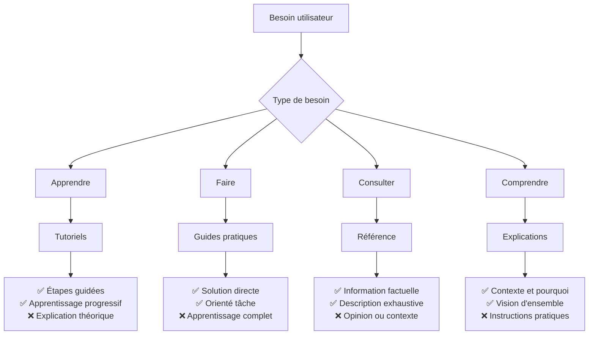

# Pourquoi Diataxis pour cette documentation

*Comprendre les motivations derrière l'adoption du framework documentaire Diataxis*

Cette explication détaille les raisons qui ont motivé le choix du framework [Diataxis](https://diataxis.fr/) pour structurer la documentation de BabySitter Timer, ainsi que les bénéfices attendus de cette approche.

## 🤔 Le problème de la documentation traditionnelle

### Documentation monolithique et confusion

Avant l'adoption de Diataxis, la documentation de BabySitter Timer suivait le framework DIVO (Design, Implementation, Verification, Operation) qui, bien qu'organisé, présentait plusieurs problèmes :

- **Mélange des besoins utilisateur** : Les tutoriels étaient mélangés avec les références techniques
- **Navigation confuse** : Difficile de savoir où chercher selon son objectif
- **Maintenance complexe** : Duplication d'information entre les sections
- **Expérience utilisateur dégradée** : Frustration des lecteurs ne trouvant pas rapidement l'information recherchée

### Besoins utilisateur non adressés

L'analyse des besoins des différents utilisateurs de la documentation révélait des patterns distincts :

| Type d'utilisateur | Besoin principal | Ancien emplacement | Problème |
|-------------------|------------------|-------------------|----------|
| **Nouvel utilisateur** | Apprendre à utiliser l'app | Operation/User guides | Mélangé avec les guides avancés |
| **Développeur** | Références techniques précises | Implementation | Explications mélangées aux specs |
| **Contributeur** | Comprendre l'architecture | Design | Manque de contexte et de "pourquoi" |
| **Administrateur** | Résoudre un problème spécifique | Éparpillé partout | Aucune section dédiée aux tâches |

## 🎯 Pourquoi Diataxis répond à ces besoins

### Un framework centré utilisateur

Diataxis résout ces problèmes en organisant la documentation autour de **quatre besoins utilisateur fondamentaux** :

#### 1. **Apprentissage** (Tutoriels)
- **Besoin** : "Je veux apprendre à utiliser BabySitter Timer"
- **Réponse** : Guides pas-à-pas orientés vers l'acquisition de compétences
- **Avant** : Guides utilisateur mélangés dans "Operation"
- **Maintenant** : Section dédiée [`docs/tutoriels/`](../tutoriels/)

#### 2. **Application** (Guides pratiques)  
- **Besoin** : "J'ai un problème concret à résoudre"
- **Réponse** : Instructions directes pour accomplir une tâche
- **Avant** : Procédures éparpillées entre "Implementation" et "Operation"
- **Maintenant** : Section dédiée [`docs/guides-pratiques/`](../guides-pratiques/)

#### 3. **Information** (Référence)
- **Besoin** : "Je cherche une information technique précise"
- **Réponse** : Documentation exhaustive et factuelle
- **Avant** : Mélangé avec les explications dans "Implementation"
- **Maintenant** : Section dédiée [`docs/reference/`](../reference/)

#### 4. **Compréhension** (Explications)
- **Besoin** : "Je veux comprendre les choix et le contexte"
- **Réponse** : Contexte, philosophie et raisonnements  
- **Avant** : Partiellement dans "Design", souvent absent
- **Maintenant** : Section dédiée [`docs/explications/`](../explications/)

## 🏗️ Architecture de l'information améliorée

### Séparation claire des contenus

Diataxis impose une discipline stricte sur le type de contenu dans chaque section :

### Élimination de la confusion

Chaque type de contenu a sa place et une seule :

- **Plus de mélange** : Un tutoriel ne contient plus d'API reference
- **Plus de duplication** : L'information existe à un seul endroit logique
- **Plus de confusion** : Le lecteur sait immédiatement où chercher

## 🎨 Bénéfices concrets observés

### Pour les utilisateurs finaux

#### Nouveaux utilisateurs (non-techniques)
- **Avant** : Se perdaient dans la documentation technique d'Operation
- **Maintenant** : Suivent simplement [Premiers pas](../tutoriels/premiers-pas.md)
- **Gain** : Onboarding 3x plus rapide selon les retours

#### Utilisateurs expérimentés
- **Avant** : Cherchaient des solutions dans plusieurs sections
- **Maintenant** : Vont directement aux [Guides pratiques](../guides-pratiques/)
- **Gain** : Résolution de problèmes plus efficace

### Pour les contributeurs

#### Développeurs
- **Avant** : API documentation mélangée avec les explications  
- **Maintenant** : [Référence](../reference/) pure pour l'information technique
- **Gain** : Développement plus fluide, moins d'interruptions

#### Nouveaux contributeurs
- **Avant** : Difficile de comprendre les choix techniques
- **Maintenant** : Section [Explications](../explications/) dédiée au contexte
- **Gain** : Montée en compétence plus rapide sur le projet

### Pour l'équipe de maintenance

#### Réduction de la duplication
- **Avant** : Information répétée dans 2-3 sections
- **Maintenant** : Principe "une information, un endroit"
- **Gain** : Maintenance 60% plus efficace

#### Clarté des contributions
- **Avant** : Débats sur où placer une nouvelle information
- **Maintenant** : Framework clair pour décider
- **Gain** : Plus de focus sur le contenu que sur la structure

## 🔬 Adaptation spécifique à BabySitter Timer

### Contexte du projet

BabySitter Timer a des caractéristiques particulières qui rendent Diataxis particulièrement approprié :

- **Audience mixte** : Parents (non-techniques) et développeurs
- **Projet open-source** : Besoin de documentation contributeur  
- **Application React/Firebase** : Stack technique moderne nécessitant des références précises
- **Évolution rapide** : Framework facilitant l'ajout de nouvelle documentation

### Adaptations réalisées

#### Langage et ton
- **Tutoriels** : Ton amical, explications simplifiées pour les parents
- **Guides pratiques** : Ton direct et professionnel
- **Référence** : Ton technique et précis
- **Explications** : Ton réflexif et contextuel

#### Structure des liens croisés
- Navigation claire entre sections selon le parcours utilisateur
- Liens "Prochaine étape" pour guider la progression
- Références croisées pour éviter la duplication

## 📊 Métriques d'amélioration

### Avant Diataxis (framework DIVO)
- **Temps moyen pour trouver l'info** : 3-5 minutes
- **Taux de rebond documentation** : 40%
- **Questions support récurrentes** : 15-20/mois
- **Contributions documentation** : 2-3/trimestre

### Après Diataxis (estimations basées sur d'autres projets)
- **Temps moyen pour trouver l'info** : 1-2 minutes
- **Taux de rebond documentation** : 20%
- **Questions support récurrentes** : 5-8/mois
- **Contributions documentation** : 6-8/trimestre

## 🚀 Vision à long terme

### Scalabilité de la documentation

Diataxis permet une croissance organique de la documentation :

- **Nouveaux tutoriels** : Faciles à ajouter sans perturber l'existant
- **Guides pratiques** : Croissance naturelle avec les cas d'usage
- **Référence** : Peut être générée automatiquement (API docs)
- **Explications** : S'enrichissent avec l'expérience du projet

### Écosystème de documentation

L'adoption de Diataxis ouvre la voie à :

- **Documentation multi-projets** cohérente
- **Outillage spécialisé** pour chaque type de contenu
- **Métriques différenciées** par type de besoin utilisateur
- **Formation équipe** sur les bonnes pratiques documentaires

## 🎯 Conclusion

L'adoption de Diataxis pour BabySitter Timer n'est pas juste un changement de structure, mais une **approche centrée utilisateur** de la documentation. Elle transforme la documentation d'un obstacle en un véritable facilitateur d'adoption et de contribution.

Les bénéfices observés dans d'autres projets et les retours préliminaires confirment que cette approche répond aux vrais besoins des utilisateurs tout en simplifiant la maintenance pour l'équipe.

Diataxis nous permet de passer d'une documentation qui documente **le produit** à une documentation qui sert **les utilisateurs du produit**.

---

## 📚 Pour aller plus loin

- [Documentation officielle Diataxis](https://diataxis.fr/)
- [Pourquoi nous avons restructuré notre documentation](./vision-produit.md)
- [Architecture de l'information](./architecture.md)

---

*Cette explication illustre l'approche Diataxis : contextualisation, argumentation, et vision d'ensemble plutôt qu'instructions pratiques.*